# Laboratoire 3 : interface graphique du système de gestion de tickets

Cours **6GEI311 Architecture des logiciels**

**Équipe :** Zongo T Julien, Zongo A Razack

Le Lab 3 donne une interface graphique au système de tickets du Lab 2. Depuis une même connexion, un Admin et plusieurs utilisateurs ouvrent chacun leur fenêtre. Les utilisateurs créent et décrivent leurs tickets, l'Admin les fait avancer dans leur cycle de vie, et chaque liste ouverte se met à jour dès qu'un autre acteur change quelque chose.

La vidéo de démonstration (scénarios de test de l'application) est jointe à la release [Lab 3 : remise en vidéo demo](https://github.com/zongo-julien/Laboratoire3_6GEI311_Architecture_des_logiciels/releases/download/lab3-remise/Lab3_demo_scenarios.mp4).

L'interface est écrite avec tkinter, sans dépendance externe, selon une architecture MVC posée sur le modèle du Lab 2. Ce modèle garde ses patrons (State, Template Method, Factory Method, Command) et en gagne un, l'Observateur. Le rapport du laboratoire, avec les maquettes Figma et les captures de toutes les fenêtres, est à la racine du dépôt, [`Lab3_6GEI311_Rapport.pdf`](Lab3_6GEI311_Rapport.pdf), avec une copie et sa source Word dans `documents/`.

La Partie 1 du Lab 2 (implémentation littérale du diagramme de classes initial) est dans un dépôt séparé : [Laboratoire2_6GEI311_Architecture_des_logiciels_Partie1](https://github.com/zongo-julien/zongo-julien-Laboratoire2_6GEI311_Architecture_des_logiciels_Partie1).

## Sommaire

1. [Installation](#installation)
2. [Lancer l'interface](#lancer-linterface)
3. [Les fenêtres](#les-fenêtres)
   - [Connexion (F1)](#connexion-f1)
   - [Gérer les tickets en Admin (F2, F7, F8)](#gérer-les-tickets-en-admin-f2-f7-f8)
   - [Mes tickets et détail d'un ticket (F3, F6)](#mes-tickets-et-détail-dun-ticket-f3-f6)
   - [Créer et éditer un ticket (F4, F5)](#créer-et-éditer-un-ticket-f4-f5)
4. [Architecture de l'interface](#architecture-de-linterface)
   - [Diagramme de classes du Lab 3](#diagramme-de-classes-du-lab-3)
5. [Lancer les tests](#lancer-les-tests)
6. [Le modèle](#le-modèle)
7. [Résultats du Lab 2](#résultats-du-lab-2)
8. [Ce que nous avons appris](#ce-que-nous-avons-appris)
9. [Structure du code](#structure-du-code)

## Installation

**Prérequis :** Python 3.10 ou plus récent et Git. Aucune dépendance externe n'est nécessaire : le projet n'utilise que la bibliothèque standard, tkinter compris.

Cloner le dépôt :

```bash
git clone https://github.com/zongo-julien/Laboratoire3_6GEI311_Architecture_des_logiciels.git
```

Se placer à la racine du dépôt :

```bash
cd Laboratoire3_6GEI311_Architecture_des_logiciels
```

## Lancer l'interface

```bash
python app.py
```

L'interface graphique utilise tkinter, inclus dans la bibliothèque standard (sous Linux, installer le paquet `python3-tk` s'il manque). Elle peut être lancée depuis n'importe quel dossier : `app.py` se place lui-même à la racine du dépôt.

- **Au démarrage**, l'application charge `donnees/sauvegarde.json` s'il existe, sinon les données de démonstration `donnees/demo.json`. Une sauvegarde illisible est signalée, puis l'application démarre sur la démonstration.
- **À la fermeture** de la fenêtre de connexion, tout le système est sauvegardé dans `donnees/sauvegarde.json`, que Git ignore. Les sessions d'édition ou de création encore ouvertes ne sont pas sauvegardées : une confirmation le rappelle avant de quitter.
- Pour **repartir de la démonstration**, supprimer `donnees/sauvegarde.json`.
- Pour **régénérer la démonstration** (`donnees/demo.json` et ses images `donnees/images/demo_*.png`) avec l'API du modèle :

```bash
python outils/generer_demo.py
```

## Les fenêtres

L'interface compte huit fenêtres, numérotées comme dans les maquettes Figma de `documents/maquettes/`. Les captures ci-dessous sont celles des fenêtres réelles, sur les données de démonstration ; toutes sont dans `documents/captures_lab3/`.

| Fenêtre | Rôle | Vue | Contrôleur |
|---|---|---|---|
| F1 Connexion | Choisir l'acteur avec lequel ouvrir une session | `vue_connexion.py` | `ControleurPrincipal` |
| F2 Liste Admin | Tout le dépôt, filtre par statut, actions en lot | `vue_liste_admin.py` | `ControleurAdmin` |
| F3 Mes tickets | Tickets créés, tickets assignés et brouillons | `vue_liste_user.py` | `ControleurUser` |
| F4 Nouveau ticket | Titre et priorité d'un nouveau ticket | `vue_nouveau_ticket.py` | `ControleurPrincipal` |
| F5 Éditeur de description | Texte, images et commentaires, en création ou en édition | `vue_edition.py` | `ControleurEdition` |
| F6 Détail d'un ticket | Lecture d'un ticket, commune aux deux rôles | `vue_detail.py` | aucun (lecture seule) |
| F7 Confirmation du lot | Opérations de l'Admin avant application | `vue_lot.py` | `ControleurAdmin` |
| F8 Rapport d'exécution | Succès et refus après application | `vue_rapport.py` | aucun (lecture seule) |

### Connexion (F1)

La connexion liste les acteurs de l'annuaire, nom à gauche et rôle à droite. « Ouvrir la session », un double-clic ou Entrée ouvre F2 pour l'Admin et F3 pour un utilisateur. La connexion reste ouverte : on peut ainsi mettre plusieurs acteurs côte à côte et voir le patron Observateur à l'œuvre. Il n'y a pas de mot de passe, l'authentification sortant du cadre du laboratoire.

Fermer la connexion quitte l'application. S'il reste des sessions d'édition ou de création ouvertes, une confirmation l'annonce, « Non » par défaut, puisque ces sessions ne sont pas sauvegardées.

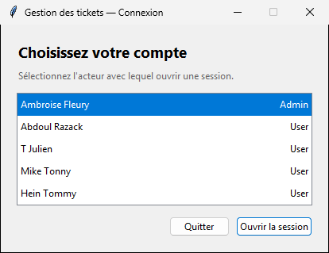

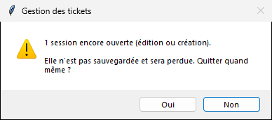

### Gérer les tickets en Admin (F2, F7, F8)

**Parcours.** Une session Admin ouvre F2 : tous les tickets du dépôt (numéro, titre, priorité, statut, créateur, assigné), filtrables par statut. On sélectionne un ou plusieurs tickets (Ctrl+clic), puis « Assigner… », « Désassigner », « Valider » ou « Fermer » ouvre F7, qui montre exactement les opérations du lot avant toute modification ; pour « Assigner… », on y choisit d'abord l'utilisateur. « Appliquer » exécute le lot « au mieux » : un refus ne bloque pas les opérations suivantes, et F8 affiche les succès et les refus avec leur motif. « Voir le détail », ou un double-clic, ouvre F6 sur la sélection.

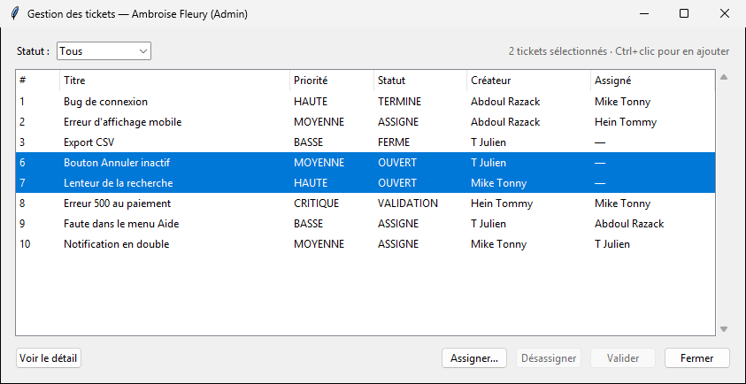

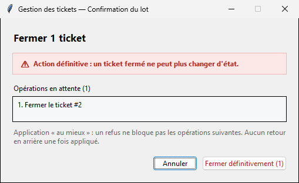

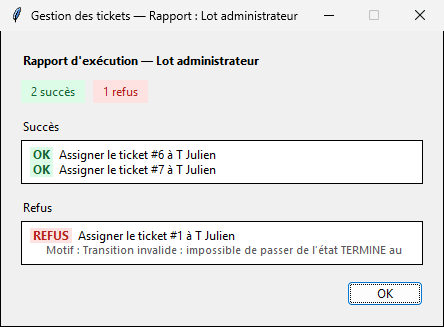

F2 est abonnée au dépôt (patron Observer) : un ticket créé ou modifié par un autre acteur y apparaît aussitôt, sans action de l'Admin, et la sélection est conservée. `ControleurAdmin` ne modifie jamais un ticket directement : il passe par `Admin.ouvrirLot()` et `LotAdmin`. Il n'importe pas tkinter et est testé dans le CI (`tests/test_controleur_admin.py`).

**Tactiques d'utilisabilité.**

| Tactique | Dans l'interface |
|---|---|
| Agrégat | Une action s'applique en un seul lot à tous les tickets sélectionnés ; F6 parcourt toute la sélection. |
| Modèle du système | Un bouton d'action n'est actif que si au moins un ticket sélectionné permet la transition (`transitionPossible()`) : les règles restent dans les états. |
| Prévention des erreurs | Pour « Fermer », action définitive, F7 affiche un avertissement et met le focus sur « Annuler » : la touche Entrée ne ferme aucun ticket. Pour « Assigner… », aucun utilisateur n'est choisi d'avance et « Appliquer » reste grisé tant qu'il ne l'est pas. |
| Annuler | « Annuler », ou Échap, ferme F7 sans rien appliquer : le lot préparé est simplement oublié. |
| Retour d'information | F7 liste les opérations en attente ; F8 donne le bilan, puis chaque succès et chaque refus avec son motif. |

### Mes tickets et détail d'un ticket (F3, F6)

**Parcours.** Une session User ouvre F3, qui ne montre que les tickets qui concernent l'utilisateur, en trois onglets : « Créés par moi », « Assignés à moi » et « Brouillons » (créations mises en pause, dont le ticket n'est pas encore dans le dépôt). La colonne « Édition » indique une session « en pause » ou « en cours ». Depuis F3 : « Nouveau ticket » ouvre F4 ; « Éditer », ou « Reprendre l'édition » pour une session en pause, ouvre F5 ; « Supprimer » retire un ticket jamais assigné, après confirmation ; « Soumettre à validation » fait passer un ticket assigné à l'état VALIDATION. « Voir le détail », ou un double-clic, ouvre F6.

F6 est commune aux deux rôles et ne fait que lire le ticket : statut, priorité, créateur, assigné, dates, puis la description (le texte, et les images PNG ou GIF, réduites au-delà de 400 px de large) et les commentaires. « ‹ Précédent » et « Suivant › » parcourent la sélection reçue de F2, ou l'onglet de F3, sans revenir à la liste.

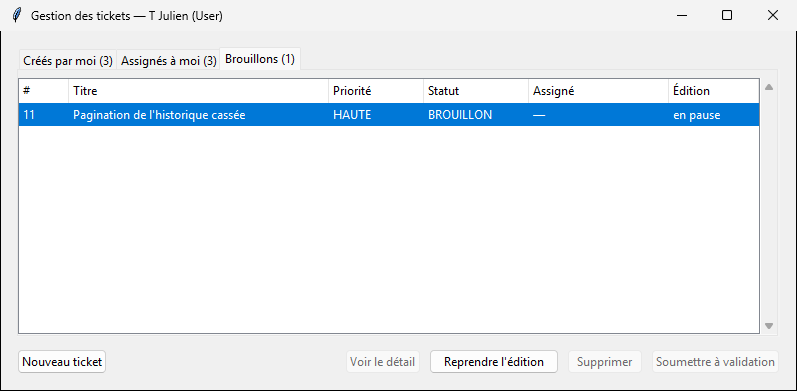

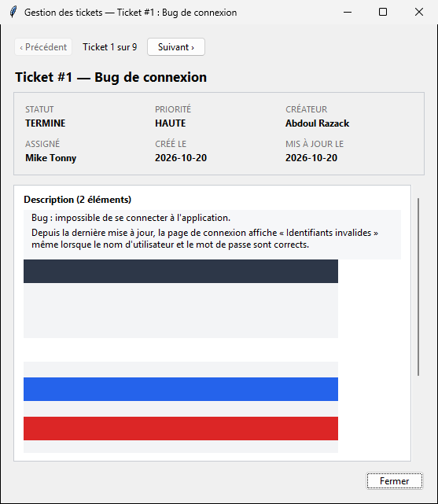

F3 et F6 sont abonnées au dépôt (patron Observer) : un changement fait par un autre acteur s'affiche aussitôt ; si le ticket affiché dans F6 est retiré, un message l'annonce et F6 passe au suivant, ou se ferme. Les sessions, elles, ne sont pas observables : F3 relit l'état des sessions de l'utilisateur toutes les 500 ms, pour qu'un brouillon mis en pause depuis F5 apparaisse aussitôt. `ControleurUser` passe par `User` (`supprimerTicket()`, `soumettreValidation()`) ; il n'importe pas tkinter et est testé dans le CI (`tests/test_controleur_user.py`).

**Tactiques d'utilisabilité.**

| Tactique | Dans l'interface |
|---|---|
| Pause et reprise | Un brouillon apparaît dans l'onglet « Brouillons » ; « Reprendre l'édition » rouvre F5 avec le texte tapé. Le bouton s'appelle « Reprendre l'édition » dès qu'une session est en pause sur le ticket choisi. |
| Prévention des erreurs | « Supprimer » n'est actif que pour un ticket créé par l'utilisateur et jamais assigné ; « Soumettre à validation » seulement pour un ticket qui lui est assigné et dont l'état le permet ; « Éditer » seulement pour un ticket qu'il a créé. La suppression demande une confirmation, « Non » par défaut. |
| Agrégat | F6 parcourt plusieurs tickets avec « ‹ Précédent » et « Suivant › » (ou Alt+← et Alt+→), sans revenir à la liste. |
| Retour d'information | Le nombre de lignes de chaque onglet est affiché dans son titre ; F6 indique « Ticket n sur N ». |

### Créer et éditer un ticket (F4, F5)

**Parcours.** Depuis la liste d'un utilisateur (F3), « Nouveau ticket » ouvre F4 : on y saisit le titre et la priorité, puis « Continuer » crée le ticket et sa `SessionCreation`, sans toucher au dépôt, et ouvre l'éditeur F5. Dans F5, on tape le texte de la description, on ajoute des images PNG ou GIF et des commentaires, qui restent en attente dans la session. « Créer le ticket » ajoute le texte tapé à la description, applique la session et affiche le rapport (F8) : c'est seulement à ce moment que le ticket entre dans le dépôt et apparaît chez les autres acteurs. Pour un ticket existant, « Éditer » dans F3 ouvre la même fenêtre F5 en mode édition, avec le bouton « Appliquer ».

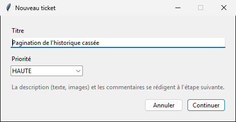

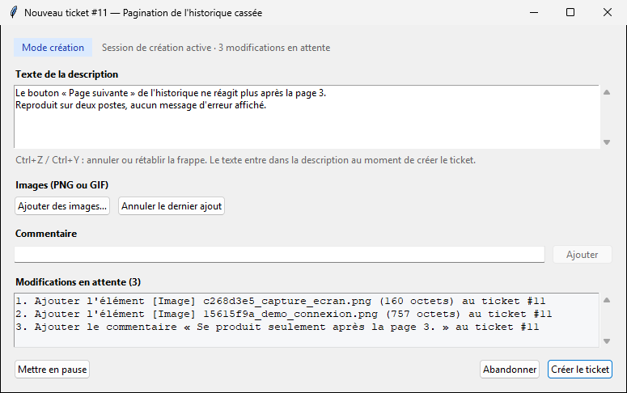

Chaque session a un seul `ControleurEdition`, qui survit à la fermeture de F5. Il garde le texte tapé pendant une pause et la pile des copies d'images (`StockageImages` copie chaque image dans `donnees/images/`).

**Tactiques d'utilisabilité.**

| Tactique | Dans l'interface |
|---|---|
| Annuler une saisie | « Annuler » dans F4 ne crée rien. « Abandonner » dans F5 renonce à toute la session, après confirmation si du texte ou des modifications seraient perdus ; les copies d'images sont supprimées et le ticket reste inchangé (ou n'est pas créé). |
| Undo de frappe | Dans la zone de texte, Ctrl+Z et Ctrl+Y annulent ou rétablissent la frappe. |
| Undo de session | « Annuler le dernier ajout » retire la dernière modification en attente (image ou commentaire) ; la copie d'une image retirée est supprimée de `donnees/images/`. |
| Pause et reprise | « Mettre en pause », ou la fermeture de F5, met la session en pause sans rien perdre. Le brouillon reste dans F3, et le reprendre rouvre F5 avec le texte tapé. |
| Agrégat | Plusieurs images s'ajoutent en une seule sélection ; les images refusées sont signalées ensemble dans une seule boîte, et les autres sont ajoutées. |
| Prévention des erreurs | Les boutons sans effet possible sont grisés : « Continuer » sans titre, « Créer le ticket » sans texte ni image, « Appliquer » sans texte ni modification, « Ajouter » sans commentaire, « Annuler le dernier ajout » sans modification en attente. |
| Retour d'information | F5 affiche le nombre et la liste des modifications en attente ; F8 présente le rapport d'exécution après l'application. |

## Architecture de l'interface

| Couche | Paquets | Règle |
|---|---|---|
| Modèle | `acteurs`, `modele`, `etats`, `description`, `sessions`, `commandes`, `persistance` | Porte les règles métier ; ne connaît pas tkinter. |
| Vues | `ihm/vues` | Lisent le modèle par ses propriétés en lecture seule et l'observent ; ne le modifient jamais. |
| Contrôleurs | `ihm/controleurs` | Font toutes les modifications, en passant par `Admin`, `User`, les sessions ou `LotAdmin` ; jamais par `ticket.updateStatus()`, `setEtat()` ni un attribut privé. |

- Seul `ControleurPrincipal` crée des fenêtres. Il charge et sauvegarde les données, et tient un registre des sessions d'édition : un seul `ControleurEdition` par session, qui survit à la fermeture de F5 et garde le texte tapé pendant une pause.
- `ControleurAdmin`, `ControleurUser` et `ControleurEdition` n'importent ni tkinter ni les vues. Ils sont donc testés dans le CI, qui n'a pas d'écran, avec un faux contrôleur principal.
- Chaque fenêtre hérite de `FenetreBase`, qui l'abonne à ses sujets à l'ouverture et l'en désabonne à la fermeture, avant de la détruire. F2, F3 et F6 observent le dépôt, qui relaie les modifications de chacun de ses tickets.
- `FenetreBase.executer()` affiche les cinq exceptions métier de `modele/exceptions.py` dans une boîte, et la fenêtre reste ouverte. Toute autre exception est un bug et remonte dans la console. En pratique, les boutons qui mèneraient à un refus sont grisés d'avance.

Les constructeurs des vues et les signatures des contrôleurs ont été figés dès la première étape du sprint, avec une ébauche de chaque fenêtre ; ce contrat est détaillé dans le rapport (section 3.2).

### Diagramme de classes du Lab 3

Le diagramme de classes du Laboratoire 3 reprend celui de la Partie 2 et y intègre ce que le Laboratoire 3 a introduit : le patron Observateur, la session de création, la persistance (`DepotJSON`, `StockageImages`) et le paquet `ihm` de l'interface graphique (MVC). Le fichier source draw.io, [`documents/Lab3_6GEI311_diagramme_classes.drawio`](documents/Lab3_6GEI311_diagramme_classes.drawio), contient cinq pages, aussi exportées en PNG : [modèle](documents/Lab3_uml_1_modele.png), [interface](documents/Lab3_uml_2_interface.png), [instanciations](documents/Lab3_uml_3_instanciations.png), [exceptions](documents/Lab3_uml_4_exceptions.png) et [cycle de vie du ticket](documents/Lab3_uml_5_cycle_de_vie.png).

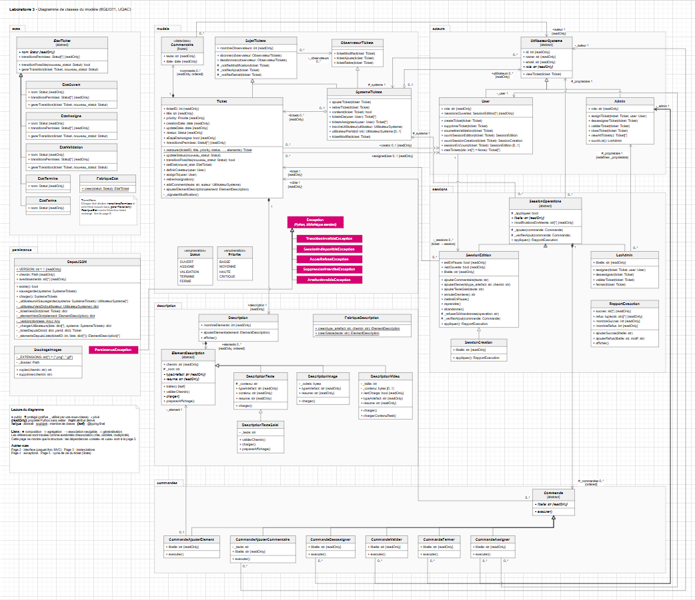

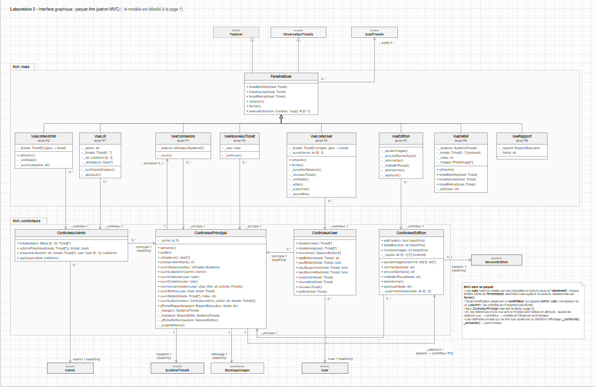

## Lancer les tests

Depuis la racine du dépôt :

```bash
python -m unittest discover -s tests -t .
```

La suite compte 145 tests, lancés aussi par GitHub Actions à chaque push et à chaque pull request. Aucun ne crée de fenêtre : les contrôleurs de l'interface (`tests/test_controleur_admin.py`, `test_controleur_user.py`, `test_controleur_edition.py`) sont testés avec un faux contrôleur principal, et `tests/test_donnees_demo.py` vérifie que la démonstration se recharge sans avertissement.

Le test de non-régression exécute `main.py` et compare sa sortie, dates neutralisées, à `tests/reference_main.txt`. Si la sortie change volontairement, régénérer la référence avec `python tests/test_non_regression.py`.

## Le modèle

Le modèle vient du Lab 2. Avant d'écrire l'interface, nous l'avons complété : sessions de création, abandon d'une session, transitions consultables, patron Observateur, sauvegarde JSON et copie des images jointes. Le rapport (section 2) explique d'où vient chacun de ces ajouts ; cette section en donne l'usage.

### Lancer la démonstration du Lab 2

```bash
python main.py
```

Le programme doit être lancé depuis la racine du dépôt, car les chemins des ressources (`ressources/...`) sont relatifs. Il exécute 17 scénarios, de A à Q, présentés dans la section [Démonstration](#démonstration-captures-décran). Chaque scénario affiche le test effectué (`Test :`) puis son résultat (`Résultat :`). Quand une opération doit être refusée, le programme capture l'exception, affiche son message et vérifie que le ticket est resté inchangé.

### Utiliser le système dans son propre code

Tous les acteurs partagent un même dépôt, `SystemeTickets`, injecté dans leur constructeur :

```python
from acteurs.admin import Admin
from acteurs.user import User
from modele.enums import Priorite
from modele.exceptions import TransitionInvalideException
from modele.systeme_tickets import SystemeTickets
from modele.ticket import Ticket

systeme = SystemeTickets()
admin = Admin(1, "Ambroise Fleury", "ambroise@uqac.ca", systeme)
abdoul = User(2, "Abdoul Razack", "abdoul@uqac.ca", systeme)
julien = User(3, "T Julien", "julien@uqac.ca", systeme)

# 1. Un utilisateur crée un ticket (statut initial : OUVERT)
ticket = Ticket(1, "Bug de connexion", Priorite.HAUTE)
abdoul.createTicket(ticket)

# 2. Son créateur le complète dans une session d'édition, puis applique
session = abdoul.ouvrirSessionEdition(ticket)
session.ajouterCommentaire("Le bug se reproduit sur Chrome.")
session.ajouterElement("texte", "ressources/description_bug.txt")
session.appliquer().afficher()

# 3. Cycle de vie : OUVERT -> ASSIGNE -> VALIDATION -> TERMINE
admin.assignTicket(ticket, julien)
julien.soumettreValidation(ticket)
admin.validerTicket(ticket)
abdoul.viewTicket(ticket)

# 4. Une transition interdite est refusée et le ticket reste intact
try:
    admin.closeTicket(ticket)
except TransitionInvalideException as erreur:
    print(erreur)
```

Sortie :

```text
  Succès :
    [OK]    Ajouter le commentaire « Le bug se reproduit sur Chrome. » au ticket #1
    [OK]    Ajouter l'élément [Texte] description_bug.txt (434 caractères) au ticket #1
  Refus :
    (aucun)
  Bilan : 2 succès, 0 refus
  Ticket #1 : Bug de connexion
    Statut       : TERMINE
    Priorité     : HAUTE
    Créateur     : Abdoul Razack
    Assigné      : T Julien
    Créé le      : 2026-10-02 | mis à jour le : 2026-10-02
    Commentaires : 1
      - Abdoul Razack (2026-10-02) : Le bug se reproduit sur Chrome.
    Éléments de description : 1
Transition invalide : impossible de passer de l'état TERMINE au statut FERME
```

### Opérations disponibles

| Objet | Méthode | Règle |
|---|---|---|
| `User` | `createTicket(ticket)` | L'utilisateur devient le créateur du ticket |
| `User` | `supprimerTicket(ticket)` | Seulement par le créateur, et si le ticket n'a jamais été assigné |
| `User` | `soumettreValidation(ticket)` | Seulement par l'assigné : `ASSIGNE` → `VALIDATION` |
| `User` | `ouvrirSessionEdition(ticket)` | Seulement par le créateur, et une seule session ouverte par ticket ; retourne une `SessionEdition` |
| `User` | `ouvrirSessionCreation(ticket)` | Seulement pour un ticket sans créateur et absent du dépôt, et une seule session ouverte par ticket ; retourne une `SessionCreation` |
| `User` | `sessionEnCours(ticket)` | Session d'édition ou de création encore ouverte sur ce ticket, même en pause ; sinon `None` |
| `User` | `sessionsOuvertes` | Propriété en lecture seule : sessions d'édition et de création encore ouvertes |
| `User` | `mesTickets(ids=None)` | Tickets créés par l'utilisateur, filtrables par identifiant |
| `Admin` | `assignTicket(ticket, user)` | Assignation, réassignation ou rejet d'une validation |
| `Admin` | `desassignerTicket(ticket)` | `ASSIGNE` → `OUVERT` |
| `Admin` | `validerTicket(ticket)` | `VALIDATION` → `TERMINE` |
| `Admin` | `closeTicket(ticket)` | `OUVERT` ou `ASSIGNE` → `FERME` |
| `Admin` | `viewAllTickets()` | Affiche et retourne tous les tickets du dépôt |
| `Admin` | `ouvrirLot()` | Retourne un `LotAdmin` |
| `User`, `Admin` | `viewTicket(ticket)` | Affiche le détail d'un ticket |
| `SessionEdition` | `ajouterCommentaire(texte)`, `ajouterElement(type, chemin)` | Ajoute une modification en attente ; `type` vaut `"texte"`, `"image"` ou `"video"` |
| `SessionEdition` | `ajouterTexteSaisi(texte)` | Ajoute en attente un texte tapé, sans fichier ; un texte vide ou blanc est refusé (`ArtefactInvalideException`) |
| `SessionEdition` | `annulerDerniere()`, `mettreEnPause()`, `reprendre()` | Gestion de la pile de modifications |
| `SessionEdition` | `abandonner()` | Renonce à toute la session avant application : vide la pile, lève la pause et ferme la session ; permise en pause, refusée si la session est déjà appliquée ou abandonnée |
| `SessionEdition` | `estOuverte` | Propriété en lecture seule : vraie tant que la session n'est ni appliquée ni abandonnée |
| `SessionEdition` | `ticket` | Propriété en lecture seule : ticket visé par la session (aussi pour `SessionCreation`) |
| `SessionCreation` | mêmes opérations que `SessionEdition` | `appliquer()` vérifie d'abord la session (déjà appliquée, abandonnée, en pause), puis crée le ticket avec `createTicket()` et applique sa description ; un refus ou un abandon laisse le ticket hors du dépôt |
| `LotAdmin` | `assigner(ticket, user)`, `desassigner(ticket)`, `validerTicket(ticket)`, `fermer(ticket)` | Prépare une opération ; ni pause, ni reprise, ni annulation |
| `SessionEdition`, `LotAdmin` | `appliquer()` | Exécute les modifications en attente et retourne un `RapportExecution` |
| `ElementDescription` | `typeArtefact` | Propriété en lecture seule : `"texte"`, `"image"` ou `"video"`, les mêmes valeurs que `FabriqueDescription.creer()` |
| `DescriptionTexte` | `contenu` | Propriété en lecture seule : texte du fichier, disponible après `traiter()` |
| `SystemeTickets` | `ticketsAssignesA(user)` | Tickets dont `user` est l'assigné actuel, y compris ceux à l'état `TERMINE` ou `FERME`, où l'assigné est conservé |
| `SystemeTickets` | `inscrireUtilisateur(utilisateur)`, `utilisateurs`, `utilisateurParId(id)` | Annuaire des utilisateurs, utilisé par la sauvegarde ; l'inscription est idempotente, et un identifiant déjà pris par un autre utilisateur lève `ValueError` |
| `Ticket` | `transitionsPermises` | Propriété en lecture seule : statuts accessibles depuis l'état courant |
| `Ticket` | `transitionPossible(statut)` | Indique si la transition serait acceptée, sans rien modifier |
| `Ticket` | `ajouterElementDescription(element)` | Ajoute un élément à la description, met à jour la date et notifie les observateurs |
| `Ticket`, `SystemeTickets` | `abonner(observateur)`, `desabonner(observateur)` | Abonne ou désabonne un `ObservateurTickets` ; s'abonner deux fois n'a pas d'effet, et se désabonner sans être abonné ne lève pas d'erreur |
| `DepotJSON` | `sauvegarder(systeme)`, `charger()`, `existe()` | Écrit tout le système dans un fichier JSON, ou le reconstruit ; voir [Sauvegarder et recharger le système](#sauvegarder-et-recharger-le-système) |
| `StockageImages` | `copier(chemin)` | Copie une image `.png` ou `.gif` dans `donnees/images/` sous un nom unique et retourne le chemin de la copie (notation POSIX), à passer tel quel à `ajouterElement("image", ...)` ; un fichier introuvable ou un autre format est refusé (`ArtefactInvalideException`) |
| `StockageImages` | `supprimer(chemin)` | Supprime une copie du dossier de stockage ; sans effet sur un fichier absent ou hors de ce dossier, donc jamais sur une image d'origine |

L'Admin ne crée, ne supprime ni n'édite aucun ticket. Chacune de ses opérations demande **la transition d'abord, la donnée ensuite** : un refus ne modifie jamais le ticket.

### Sauvegarder et recharger le système

`DepotJSON` enregistre tout le système (utilisateurs, tickets, commentaires et descriptions) dans un fichier JSON, puis le reconstruit :

```python
from persistance.depot_json import DepotJSON

depot = DepotJSON("sauvegarde.json")
depot.sauvegarder(systeme)
systeme = depot.charger()
```

- Les utilisateurs sauvegardés sont ceux de l'annuaire (`inscrireUtilisateur()`) et ceux qui sont cités dans les tickets ; dans un ticket, chaque utilisateur est remplacé par son identifiant.
- Les fichiers de description sont sauvegardés par leur chemin, sans être copiés ; un texte saisi est sauvegardé avec son contenu.
- L'écriture passe par un fichier temporaire : une sauvegarde interrompue ne remplace pas l'ancienne.
- Au chargement, `Ticket.restaurer()` remet chaque ticket dans l'état sauvegardé, dates comprises, sans rejouer la machine à états ; `FabriqueEtat` construit l'état qui correspond au statut enregistré.
- Un fichier de description introuvable est ignoré et signalé dans `depot.avertissements`. Un fichier de sauvegarde illisible, d'une autre version ou incohérent lève `PersistanceException` ; un fichier absent lève `FileNotFoundError` (voir `depot.existe()`).
- Les sessions non appliquées ne sont pas sauvegardées.

### Patrons de conception

#### State — `etats/`, `modele/ticket.py`

Le statut d'un ticket n'est pas stocké : la propriété `status` (en lecture seule) est dérivée de l'état courant. `Ticket.updateStatus()` délègue entièrement la décision à l'état, qui accepte la transition (en instanciant le nouvel état) ou lève `TransitionInvalideException`.

| État | Transitions autorisées |
|---|---|
| `OUVERT` | `ASSIGNE`, `FERME` |
| `ASSIGNE` | `ASSIGNE` (réassignation), `OUVERT` (désassignation), `VALIDATION`, `FERME` |
| `VALIDATION` | `ASSIGNE` (rejet), `TERMINE` |
| `TERMINE` | aucune (état terminal) |
| `FERME` | aucune (état terminal) |

Chaque état déclare aussi les statuts qu'il accepte dans `transitionsPermises`. `Ticket.transitionPossible(statut)` permet ainsi de savoir si une transition serait acceptée sans la tenter et sans recopier les règles ailleurs. Comme ces règles sont écrites à deux endroits (`transitionsPermises` les annonce, `gererTransition()` les applique), un test essaie chaque état avec chaque statut et vérifie que les deux disent la même chose.

#### Template Method — `description/element_description.py`

`ElementDescription.traiter()` (marquée `@typing.final`) fixe l'ordre des étapes : `validerChemin()` → `charger()` → `preparerAffichage()`. `charger()` varie selon le type d'artefact (texte, image, vidéo) ; faute de fichier, `DescriptionTexteSaisi` (texte tapé par l'utilisateur) redéfinit aussi `validerChemin()`, qui refuse un texte vide, et `preparerAffichage()`, qui affiche le nom « texte saisi ». `DescriptionVideo` pratique le **chargement différé** : `charger()` ne lit que la taille du fichier, et le contenu n'est lu que par `chargerContenuReel()`.

#### Factory Method — `description/fabrique_description.py`, `etats/fabrique_etat.py`

`FabriqueDescription.creer(type_artefact, chemin)` crée l'élément voulu (`"texte"`, `"image"`, `"video"`) sans le charger ; tout autre type lève `ArtefactInvalideException`. `FabriqueDescription.creerSaisie(texte)` crée de même, sans le charger, un élément à partir d'un texte tapé par l'utilisateur, sans fichier. La fabrique est le seul endroit du programme qui connaît les sous-classes concrètes.

`FabriqueEtat.creer(statut)` joue le même rôle pour les états : au chargement d'une sauvegarde, elle construit l'état qui correspond au statut enregistré. Un test vérifie que chaque valeur de `Statut` a son état.

#### Command — `commandes/`, `sessions/`

Les modifications sont empilées sous forme de commandes dans une session, puis appliquées d'un coup par `appliquer()`, qui retourne un `RapportExecution`. L'application se fait « au mieux » : une commande refusée ne bloque pas les suivantes, et une commande dont le ticket a été retiré du dépôt est refusée avec le motif « ticket retiré du dépôt ».

- `SessionEdition` (côté User) : commentaires et éléments de description ; annulation de la dernière modification, pause et reprise.
- `SessionCreation` (côté User) : session d'édition d'un nouveau ticket, qui n'existe pour les autres qu'une fois sa description appliquée. `appliquer()` l'enregistre dans le dépôt avec `createTicket()` juste avant d'exécuter les modifications ; un refus ou un abandon le laisse hors du dépôt.
- `LotAdmin` (côté Admin) : assigner, désassigner, valider, fermer ; ni pause, ni reprise, ni annulation.

Dans une session d'édition, `annulerDerniere()` défait seulement la dernière modification en attente (undo), alors que `abandonner()` renonce à toute la session : la pile est vidée, la session est fermée et le ticket reste inchangé.

#### Observateur — `modele/observateur.py`, `modele/ticket.py`, `modele/systeme_tickets.py`

`ObservateurTickets` est l'interface des observateurs : ses méthodes `ticketModifie`, `ticketAjoute` et `ticketRetire` ne font rien par défaut, et chaque observateur ne redéfinit que celles qui l'intéressent. `SujetTickets` tient la liste des abonnés (`abonner()`, `desabonner()`) et les notifie.

- `Ticket` est un sujet : toutes ses modifications (état, créateur, assigné, commentaire, élément de description) passent par `_signalerModification()`, qui met à jour `updateDate`, désormais à chaque modification du ticket et non plus seulement aux transitions comme au Lab 2, puis notifie ses abonnés. Une transition refusée ne notifie rien.
- `SystemeTickets` est à la fois sujet et observateur : il s'abonne à chaque ticket ajouté, s'en désabonne au retrait et retransmet ses modifications à ses propres abonnés (relais). Il notifie aussi les ajouts et les retraits de tickets.

Un observateur doit se désabonner quand il disparaît ; sinon, il continue d'être appelé et reste en mémoire. Pour que l'ajout d'un élément de description soit notifié, il faut passer par `ticket.ajouterElementDescription()` et non par `ticket.description.ajouterElement()` ; `CommandeAjouterElement` passe désormais par cette méthode.

## Résultats du Lab 2

### Partie 1 : diagramme initial

La Partie 1 traduit littéralement le diagramme de classes fourni : trois classes, `User`, `Admin` et `Ticket`. Le statut y est une simple chaîne de caractères, sans aucune règle de transition, et l'assigné et les commentaires ne sont pas mémorisés, faute d'attribut prévu dans le diagramme. Le code se trouve dans le [dépôt de la Partie 1](https://github.com/zongo-julien/Laboratoire2_6GEI311_Architecture_des_logiciels_Partie1).


### Partie 2 : diagramme amélioré

Le diagramme de la Partie 2 corrige les défauts de la Partie 1 et ajoute les sessions d'édition, les lots administrateur et les descriptions multimédias. Cliquer sur l'image pour l'agrandir. Le fichier source draw.io est disponible dans [`documents/Lab2_6GEI311_diagramme_classes_partie2.drawio`](documents/Lab2_6GEI311_diagramme_classes_partie2.drawio).

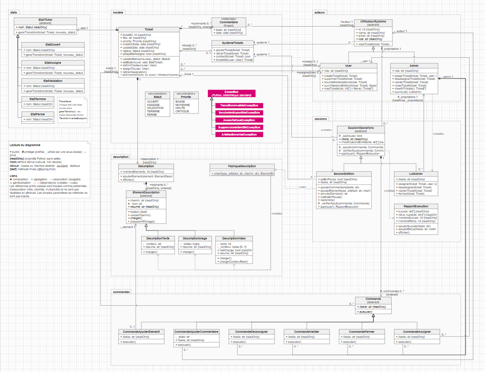

### Fonctionnalités implémentées

| Fonctionnalité | Acteur | Scénarios |
|---|---|---|
| Création de tickets | User | A |
| Suppression d'un ticket, seulement par son créateur et s'il n'a jamais été assigné | User | N |
| Consultation : `mesTickets()` avec ou sans filtre, `viewTicket()`, `viewAllTickets()` | User, Admin | B, C, G, Q |
| Session d'édition : modifications en attente, annulation, pause et reprise, application groupée avec rapport | User | D, E, F, G, H |
| Session de création : le ticket n'entre dans le dépôt qu'à l'application de sa description | User | — (tests unitaires) |
| Une seule session ouverte par ticket, de nouveau permise après application ou abandon | User | — (tests unitaires) |
| Consultation des tickets assignés à un utilisateur | User | — (tests unitaires) |
| Transitions permises consultables sans modifier le ticket | — | — (tests unitaires) |
| Notification des observateurs à chaque modification d'un ticket, relayée par le dépôt | — | — (tests unitaires) |
| Sauvegarde et rechargement du système en JSON | — | — (tests unitaires) |
| Description multimédia (texte, image, vidéo) avec chargement différé de la vidéo | User | D, G |
| Cycle de vie contrôlé par une machine à états | Admin, User | J, K, O |
| Réassignation directe et rejet d'une validation | Admin | L |
| Désassignation | Admin | M |
| Fermeture et états terminaux | Admin | O |
| Lot administrateur appliqué « au mieux » | Admin | P |
| Contrôles d'accès (créateur, assigné, rôle) | User, Admin | I, K, N, Q |
| Statut en lecture seule | — | Q |

### Démonstration (captures d'écran)

Sortie de `python main.py`, scénario par scénario.

#### A à C : création, agrégat `mesTickets()` et consultation par l'Admin

Deux utilisateurs créent quatre tickets, qui démarrent tous à l'état `OUVERT`. `mesTickets()` ne retourne que les tickets de leur créateur, et l'Admin voit l'ensemble du dépôt.


#### D à F : session d'édition, annulation, pause et reprise

Les cinq modifications restent en attente : le ticket T1 ne change pas avant `appliquer()`. L'annulation retire la dernière modification, et pendant la pause tout ajout, annulation ou application est refusé.


#### G à I : application de la session, session close et accès refusé

`appliquer()` produit un rapport de 5 succès. La vidéo n'est chargée réellement qu'à l'appel de `chargerContenuReel()`. Une session déjà appliquée refuse tout nouvel ajout, et un utilisateur qui n'est pas le créateur ne peut pas ouvrir de session sur le ticket.


#### J à M : cycle nominal, refus de transition, réassignation et désassignation

Le cycle `OUVERT` → `ASSIGNE` → `VALIDATION` → `TERMINE` est accepté. Un non-assigné ne peut pas soumettre en validation, et l'Admin ne peut pas valider un ticket qui n'est pas en validation. La réassignation directe, le rejet d'une validation et la désassignation fonctionnent.


#### N et O : suppression, fermeture et états terminaux

Un ticket jamais assigné peut être supprimé par son créateur, mais pas un ticket déjà assigné ni le ticket d'un autre utilisateur. Une fois `TERMINE` ou `FERME`, un ticket n'accepte plus aucune transition.


#### P et Q : lot administrateur, bilan et protections

Le lot de quatre opérations donne 1 succès et 3 refus : transition invalide deux fois, et ticket retiré du dépôt avant l'application. Écrire directement `T1.status` est refusé, et les méthodes réservées à un autre rôle n'existent tout simplement pas sur l'objet.


## Ce que nous avons appris

### Au Lab 3

**Figer le contrat avant le code.** Dès la première étape du sprint, toutes les fenêtres existaient sous forme d'ébauches, avec leurs constructeurs définitifs. Écrire des fenêtres qui ne faisaient rien ressemblait à du temps perdu ; c'est pourtant ce qui nous a laissés travailler en parallèle, avec quatre pull requests fusionnées sans conflit.

**L'Observateur a un coût de sortie.** S'abonner est facile ; le piège est la fenêtre fermée qui reste abonnée. Le désabonnement, avant la destruction, est devenu une règle de `FenetreBase` plutôt qu'une chose à laquelle chaque vue doit penser. Les sessions, elles, ne notifient rien : F3 relit leur état toutes les 500 ms, un contournement que nous remplacerions avec plus de temps.

**Griser plutôt que refuser.** Le modèle refusait déjà les opérations interdites par des exceptions. Griser les boutons d'avance, en posant au modèle la question qu'il se posera lui-même (`transitionPossible()`), s'est révélé plus clair pour l'utilisateur et plus simple à tester.

**Tester sans écran oblige à bien découper.** Le CI n'a pas d'écran. Cette contrainte nous a forcés à garder tkinter hors des contrôleurs, et c'est elle qui a rendu toute la logique de l'interface testable.

### Au Lab 2

**Voir le défaut avant de le corriger.** En Partie 1, rien n'empêche de passer d'`OUVERT` à `TERMINÉ`. En Partie 2, la même demande lève une exception, et `ticket.status = …` aussi. Avoir écrit la mauvaise version d'abord a rendu chaque critique de la conception initiale facile et vérifiable.

**Le principe ouvert/fermé a ses limites.** Ajouter un état oblige à modifier l'état qui doit y mener, et un nouveau type d'artefact coûte une ligne dans la fabrique. Les patrons ne suppriment pas la modification, ils la ramènent à un endroit qu'on sait retrouver.

**Relire l'énoncé contre le modèle.** Notre première version interdisait la réassignation, que le client a ensuite demandée. La corriger n'a touché que deux classes d'état. De même, Pylance a signalé qu'un `Admin` ne pouvait pas être l'auteur d'un commentaire typé `User` : l'erreur était dans le modèle, pas dans le code.

**L'essentiel.** Toujours revenir vers le client pour connaître ses besoins profonds, qu'il aura mal ou pas assez explicités, dans un cahier des charges par exemple.

## Structure du code

```
main.py                     scénarios de démonstration A à Q
app.py                      point d'entrée de l'interface graphique (tkinter)
Lab3_6GEI311_Rapport.pdf    rapport du Lab 3 (copie de documents/Lab3_6GEI311_Rapport.pdf)
modele/
  enums.py                  Statut, Priorite
  exceptions.py             les cinq exceptions métier
  commentaire.py            Commentaire (dataclass gelée)
  observateur.py            ObservateurTickets, SujetTickets (patron Observateur)
  ticket.py                 Ticket, contexte de la machine à états
  systeme_tickets.py        SystemeTickets, dépôt des tickets et annuaire des utilisateurs
etats/                      EtatTicket, les cinq états concrets et FabriqueEtat
description/                Description, ElementDescription, sous-classes, fabrique
acteurs/                    UtilisateurSysteme, User, Admin
commandes/                  Commande et les six commandes concrètes
sessions/                   SessionOperations, SessionEdition, SessionCreation, LotAdmin, RapportExecution
persistance/
  depot_json.py             DepotJSON, sauvegarde et rechargement en JSON
  stockage_images.py        StockageImages, copie des images jointes dans donnees/images/
ihm/
  vues/                     FenetreBase et une fenêtre tkinter par écran (F1 à F8)
  controleurs/              ControleurPrincipal (navigation, données) et contrôleurs sans tkinter
outils/
  generer_demo.py           génère donnees/demo.json et ses images avec l'API du modèle
donnees/
  demo.json                 données de démonstration (versionnées)
  images/                   images de la démonstration (demo_*.png) et copies faites par l'application
  sauvegarde.json           état sauvegardé à la fermeture de l'interface (ignoré par Git)
ressources/                 artefacts de démonstration (texte, image PNG, vidéo factice)
documents/                  diagrammes UML, documents de sprint et rapports
  Lab3_6GEI311_Rapport.pdf  rapport du Lab 3 (source : Lab3_6GEI311_Rapport.docx)
  Lab3_uml_*.png            diagramme de classes du Lab 3 (source : Lab3_6GEI311_diagramme_classes.drawio)
  maquettes/                maquettes Figma des fenêtres de l'interface
  captures_lab3/            captures des fenêtres réelles, pour le rapport et ce README
  captures/                 captures de la sortie de main.py (Lab 2)
tests/                      tests unitaires et test de non-régression de main.py
```

### Conventions de code

- Tous les attributs d'instance sont privés (préfixe `_`) ; les lectures passent par des propriétés en lecture seule, et aucune méthode `getX()` n'existe.
- Seules quelques méthodes désignées affichent (`viewTicket`, `viewAllTickets`, `Description.afficher`, `RapportExecution.afficher`) ; le reste de l'affichage est fait dans `main.py`.
- Les imports servant uniquement aux annotations sont placés sous `if TYPE_CHECKING:`. Les états se référençant mutuellement, chaque état importe ses successeurs localement dans `gererTransition()`.
